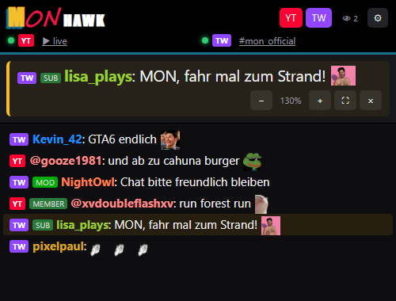

# MONHawk 🦅

**Eyes on every chat.** MONHawk merges MON's **Twitch** and **YouTube** live chat into one window, so you can follow both at once, pin a message, blow it up big and react to it.



> Fan-made tool for the streamer MON ([twitch.tv/mon_official](https://www.twitch.tv/mon_official) · [YouTube](https://www.youtube.com/channel/UCVsSnnJ8fL5PwOokVLsbAMw)). Not affiliated with MON, Twitch or YouTube.

## Features

- **One merged chat** – Twitch (`mon_official`) and YouTube in one feed, each message tagged `TW` / `YT`.
- **Finds the YouTube stream by itself** – no link needed; when MON is offline it checks again every minute.
- **Pin a message** – click any message to pin it at the top (one at a time). Click it again, press **Esc** or **×** to unpin.
- **Zoom the pin** – `−` / `+` buttons, **Ctrl + mouse wheel** on the pin, or the **+ / −** keys (80 – 600 %).
- **Spotlight** – **⛶**, double-click the pin or press **F**: the pinned message fills the whole window (great for reacting on stream or as an OBS window capture).
- **Emotes** – Twitch emotes, YouTube emojis, plus **7TV** and **BTTV** (global + MON's channel emotes), on both platforms. Zero-width emotes stack like in Chatterino.
- **Filters** – YT / TW buttons, plus the **👁** menu to show/hide **Streamer (HOST)**, **Moderators (MOD)** and **Bots**. All three are hidden by default; your choice is remembered.
- **Badges & events** – MOD / VIP / SUB / MEMBER / HOST labels, Super Chats, bits, subs and memberships highlighted, deleted messages and timeouts struck through.
- **Settings (⚙)** – Twitch channel, YouTube channel(s), bot list, font size.
- **No login, no API key, no server** – reads public chat only.

## Installation

MONHawk isn't in any extension store (yet), so you load it as an *unpacked* extension.

**First, download it:**
- On GitHub click **Code → Download ZIP** and unzip it somewhere permanent (e.g. `Documents\MONHawk`), **or**
- `git clone https://github.com/<your-account>/MONHawk.git`

> Don't delete or move the folder afterwards – the browser loads the extension from it.

### Google Chrome
1. Open `chrome://extensions`
2. Turn on **Developer mode** (top right).
3. Click **Load unpacked** and select the MONHawk folder (the one containing `manifest.json`).
4. Pin it: click the puzzle icon 🧩 in the toolbar → pin **MONHawk**.
5. Click the MONHawk icon – the chat opens in its own window.

### Microsoft Edge
1. Open `edge://extensions`
2. Turn on **Developer mode** (left sidebar / bottom left).
3. Click **Load unpacked** and select the MONHawk folder.
4. Click the puzzle icon in the toolbar → eye icon to show **MONHawk**, then click it.

### Brave
1. Open `brave://extensions`
2. Turn on **Developer mode** (top right).
3. Click **Load unpacked** and select the MONHawk folder.
4. Pin it via the puzzle icon and click it.

### Opera / Opera GX
1. Open `opera://extensions`
2. Turn on **Developer mode** (top right).
3. Click **Load unpacked** and select the MONHawk folder.
4. Pin it via the cube/extensions icon in the toolbar and click it.

### Vivaldi
1. Open `vivaldi://extensions`
2. Turn on **Developer mode** (top right).
3. Click **Load unpacked** and select the MONHawk folder.

### Arc
1. Open `arc://extensions`
2. Turn on **Developer mode**, click **Load unpacked** and select the MONHawk folder.

### Firefox (experimental, untested)
Firefox only keeps unsigned extensions until the browser is closed.
1. Open `about:debugging#/runtime/this-firefox`
2. Click **Load Temporary Add-on…** and select the `manifest.json` file in the MONHawk folder.
3. **Important:** open `about:addons` → MONHawk → **Permissions** and allow access to **www.youtube.com** – otherwise YouTube chat can't load (Firefox doesn't grant this automatically).
4. Click the MONHawk icon in the toolbar.

You have to repeat this after every Firefox restart. For a permanent install the add-on would need to be signed through [addons.mozilla.org](https://addons.mozilla.org/developers/).

### Safari, phones and tablets
Not supported. Safari would need the extension converted with Xcode on a Mac; mobile browsers don't support this kind of extension.

### Updating
Download the new version into the same folder (or `git pull`), then open your browser's extensions page and click the **reload ↻** icon on MONHawk.

> Chromium browsers may show a "Disable developer mode extensions" notice on startup – just close it.

## Usage

| Action | How |
|---|---|
| Open the chat | Click the MONHawk toolbar icon |
| Pin / unpin a message | Click it (only one pin at a time) |
| Zoom the pin | `−` `+` buttons, Ctrl + wheel, or `+` / `−` keys |
| Spotlight (full window) | `⛶`, double-click the pin, or `F` |
| Leave spotlight / unpin | `Esc` |
| Hide YouTube or Twitch | **YT** / **TW** buttons |
| Show host / mod / bot messages | **👁** menu |
| Jump back to newest | **↓ New messages** button (appears when you scroll up) |
| Change channels, bots, font size | **⚙** |

## How it works

| Part | Source |
|---|---|
| Twitch chat | Twitch IRC over WebSocket, anonymous read-only login |
| YouTube stream | the channel's `/live` page → current video ID |
| YouTube chat | YouTube's own live-chat endpoint (`youtubei/v1/live_chat/get_live_chat`), polled every 1–5 s |
| 7TV / BTTV emotes | public APIs of [7tv.io](https://7tv.io) and [betterttv.net](https://betterttv.net) |

The extension only requests access to `www.youtube.com`. A session rule removes the `Origin: chrome-extension://…` header from MONHawk's own requests to YouTube's chat endpoint, because YouTube may reject requests that carry it.

YouTube's chat endpoint is unofficial – if YouTube changes it, the YouTube side may break until MONHawk is updated. Errors are shown directly in the chat; for details right-click the window → **Inspect → Console** and look for `[YT]` lines.

## Project structure

```
manifest.json   extension manifest (MV3)
background.js   opens / focuses the chat window when the toolbar icon is clicked
chat.html       chat window markup
chat.css        styling (MON colors: yellow #f5be28, teal #18708c, red #e8174a)
chat.js         Twitch + YouTube clients, emotes, pinning, filters, settings
icons/          toolbar / extension icons
docs/           screenshot for this README
```

## Ideas / not yet implemented

Sending messages (needs Twitch/Google login), mod tools, user cards with message history, recent-message history on join, FFZ emotes, highlight words and sounds, a transparent OBS overlay of the pinned message.
